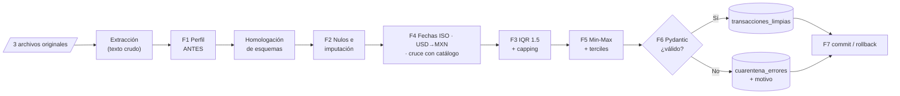

# PRIMER AVANCE · PROYECTO INTEGRADOR UNIDAD 2

**Proyecto:** Sistema de Integración y Calidad de Datos Comerciales *(nombre provisional)*
**Materia:** Ingeniería de Datos (ATD-2602) · Unidad 2: Limpieza y Preprocesamiento de Datos
**Docente:** Prof. Armando Román Gallardo Heredia · TecNM Campus Colima · Ago-Dic 2026
**Grupo / sector:** Grupo 1 (LCS2) · Retail & E-commerce Omnicanal
**Equipo y roles:**

| Rol (guía oficial, sección 2) | Integrante |
|---|---|
| Ingeniero/a 1 · Calidad, Nulos y Outliers | Leslie |
| Ingeniero/a 2 · Transformación e Integración | Yerik |
| Ingeniero/a 3 · Validación, Resiliencia y BD | Nono |

---

## Estado del avance (honesto)

| Componente | Estado | Evidencia |
|---|---|---|
| Lectura y análisis de los 3 archivos oficiales | ✅ Terminado | `diagnostico/resultados_diagnostico.json` |
| Diagnóstico cuantitativo de calidad (Fase 1) | ✅ Script ejecutado | `diagnostico/diagnostico_inicial.py`, `diagnostico/salida_consola.txt` |
| `REGLAS_DE_NEGOCIO.md` con justificación técnica | ✅ Redactado · ⏳ **pendiente de firma** | `REGLAS_DE_NEGOCIO.md` |
| Diagrama de flujo del pipeline (mockup) | ✅ Terminado | `DIAGRAMA_PIPELINE.md`, `diagramas/*.png` |
| Contratos entre módulos y plan de trabajo | ✅ Definidos | `GUIA_GENERAL_PROYECTO.md` + 3 guías individuales |
| Código del pipeline (Fases 2 a 7) | ⏳ No iniciado (conforme al cronograma: Días 2–4) | — |
| Interfaz web | ⬜ Fuera del alcance obligatorio; posterior al Día 4 | — |

Los archivos originales **no se modificaron**: el diagnóstico registra su huella SHA-256 para comprobarlo al final.

---

## A. Reglas de negocio

El documento completo es **`REGLAS_DE_NEGOCIO.md`**. Distingue 🟥 las reglas exigidas en los lineamientos de 🟦 las decisiones del equipo, y cada decisión se justifica con cifras del diagnóstico. Resumen:

| Situación | Acción | Casos reales | Tipo de regla |
|---|---|---|---|
| Fechas en 3 formatos (POS) y epoch (web) | Homologar a YYYY-MM-DD | 413 + 600 | 🟥 |
| Precios en USD | × 19.50 → MXN (se guarda el original) | 193 | 🟥 |
| `monto_total_mxn` vacío | Recalcular `cantidad × precio` | 32 | 🟥 |
| Total web = 80 × (unidades × precio) | Recalcular y guardar el original | 12 | 🟦 |
| `id_cliente`, correo y dirección vacíos | `ANONIMO`, `SIN_CORREO`, `SIN_DIRECCION` | 127 / 20 / 77 | 🟥 etiqueta · 🟦 nombres |
| Cantidad 99 o 500 ("bots") | Capping IQR a 8 en una columna analítica | 13 | 🟥 |
| Importe sobre el límite IQR | Capping en `monto_total_mxn_cap` | 80 (referencia) | 🟥 |
| Duplicado exacto | Cuarentena `DUPLICADO_EXACTO` | 20 | 🟦 |
| Cantidad ≤ 0 | Cuarentena `CANTIDAD_INVALIDA` | 11 | 🟥 |
| Producto fuera del catálogo | Cuarentena `PRODUCTO_HUERFANO` | 62 | 🟥 |
| Correo malformado | Cuarentena `EMAIL_MALFORMADO` | 28 | 🟦 |

**Resultado esperado:** 1,220 registros de entrada → **1,104** en `transacciones_limpias` y **116** en `cuarentena_errores`.

---

## B. Diagrama de flujo del pipeline

Versión completa con Mermaid en **`DIAGRAMA_PIPELINE.md`**. Las imágenes para el reporte están en `diagramas/01_flujo_pipeline.png`, `02_contratos_modulos.png` y `03_bifurcacion_validacion.png`.

Las fases anteriores a la F6 **no eliminan filas**: solo corrigen y marcan. El rechazo se decide en un único punto (Pydantic), lo que garantiza `entrada = limpias + cuarentena`.

---

## C. Diagnóstico inicial de calidad

Todas las cifras se obtuvieron con `python diagnostico/diagnostico_inicial.py` sobre los archivos oficiales. No hay valores estimados a mano.

### C.1 Dimensiones, completitud y unicidad

| Archivo | Filas | Columnas | Completitud global | Duplicados exactos |
|---|---|---|---|---|
| `catalogo_productos.csv` | 50 | 6 | 100 % | 0 |
| `ventas_tienda_fisica.csv` | 620 | 9 | 97.15 % | **20** |
| `ventas_online.json` | 600 | 11 | 98.53 % | 0 |

### C.2 Tipos de datos inferidos

| Archivo | Columna | dtype (pandas) | Observación |
|---|---|---|---|
| POS | `fecha_venta` | str | texto en 3 formatos |
| POS | `cantidad` | int64 | incluye −1 y 0 |
| POS | `precio_unitario`, `monto_total_mxn` | float64 | — |
| POS | `id_ticket`, `sucursal`, `id_producto`, `id_cliente`, `metodo_pago` | str | — |
| Web | `order_timestamp` | **object** | 392 `str` + 208 `int` (epoch) en el mismo campo |
| Web | `units` | int64 | — |
| Web | `unit_price`, `total_amount` | float64 | moneda mixta |
| Web | `customer_email`, `shipping_address` | str / None | con `null` y `""` |

### C.3 Porcentaje de nulos (solo las columnas con faltantes)

| Archivo | Columna | Nulos | % | Clasificación (χ²) |
|---|---|---|---|---|
| POS | `id_cliente` | 127 | 20.48 % | MCAR (p = 0.714 vs sucursal; 0.571 vs método de pago) |
| POS | `monto_total_mxn` | 32 | 5.16 % | MCAR (p = 0.479; 0.569); recalculable al 100 % |
| Web | `shipping_address` | 77 | 12.83 % | MCAR (p = 0.280 vs estado; 0.532 vs pasarela) |
| Web | `customer_email` | 20 (15 null + 5 `""`) | 3.33 % | MCAR (p = 0.779 vs pasarela; 0.314 vs moneda) |

Las demás columnas tienen 0 nulos.

### C.4 Importes sospechosos

| Hallazgo | Evidencia |
|---|---|
| Asimetría extrema del monto POS | media **$16,586.74** vs mediana **$3,506.37**; asimetría 14.08; máximo $2,109,055.00 |
| IQR del monto POS crudo | Q1 1,869.66 · Q3 7,811.70 · LS 16,724.76 → **37** sobre el límite |
| IQR del total web crudo (USD y MXN mezclados) | LS 7,659.30 → 37 sobre el límite (cálculo **no válido** por mezclar monedas) |
| IQR del total web convertido a MXN | LS 8,100.74 → 47 sobre el límite |
| Totales web inflados ×80 | 12 pedidos (ej. `WEB-00508`: 826,360.80 en lugar de 10,329.51) |
| Montos negativos o cero (POS) | 6 negativos y 5 en cero, en los mismos tickets con cantidad ≤ 0 |
| Precio vs catálogo | POS: 0 diferencias. Web: 387 MXN exactos; 180 USD × 19.50 con diferencia máxima de $0.095 |

### C.5 Cantidades inválidas o atípicas

| Canal | Distribución de la cantidad | Inválidas (≤ 0) | Atípicas (IQR) |
|---|---|---|---|
| POS | −1 ×6 · 0 ×5 · 1 ×172 · 2 ×165 · 3 ×92 · 4 ×78 · 5 ×89 · 99 ×7 · 500 ×6 | **11** | **13** (LS = 8.5, base sin inválidas) |
| Web | 1 ×362 · 2 ×127 · 3 ×111 | 0 | 0 (LS = 3.5) |

### C.6 Llaves huérfanas (cruce con el catálogo)

| Canal | Registros | IDs distintos | Patrón |
|---|---|---|---|
| POS | **29** | 22 (`PROD-9xx`) | todos con precio fijo de 500.00 |
| Web | **33** | 30 (`PROD-8xx`) | precio fijo de 600.00 MXN o 30.77 USD |

### C.7 Distribuciones relevantes

| Variable | Distribución |
|---|---|
| Sucursal (POS) | Manzanillo Puerto 166 · Tecomán 160 · Colima Centro 147 · Villa de Álvarez 147 |
| Moneda (web) | MXN 407 · USD 193 |
| Estado del pedido (web, homologado) | COMPLETADO 192 · CANCELADO 119 · DEVUELTO 111 · PAGADO 93 · PENDIENTE 85 |
| Pasarela (web) | OXXO Pay 167 · PayPal 149 · Stripe 147 · MercadoPago 137 |
| Categoría (catálogo) | Hogar 14 · Alimentos 12 · Juguetería 10 · Electrónica 7 · Ropa 5 · Deportes 2 |
| Periodo de ventas | POS 2026-09-01 a 2026-10-15 · Web 2026-09-01 a 2026-10-16 (hora de México) |

### C.8 Valores que requieren transformación

| Transformación | Registros afectados |
|---|---|
| Fecha `DD/MM/YYYY` → ISO | 208 |
| Fecha `DD-MM-YYYY` → ISO | 205 |
| Fecha ISO con hora → ISO | 392 |
| Fecha epoch → ISO (UTC → hora de México) | 208 (49 cambian de día) |
| USD → MXN | 193 |
| `efectivo` → `EFECTIVO` | 89 |
| `completado` → `COMPLETADO` | 98 |
| Correos malformados (`usuario@@gmail..com` 11 · `sin_arroba_dominio.org` 9 · `correo_invalido.com` 8) | 28 |

### C.9 Hallazgo técnico: trampa en el parseo de fechas

Si se usa `pd.to_datetime(format="mixed", dayfirst=True)`, pandas interpreta mal **104 fechas** (lee `2026-09-01` como el 9 de enero) y el periodo aparente pasa a ser 2026-01-09 a 2026-12-10. Por eso el equipo usará parseo explícito por patrón (regla R8.2).

---

## D. Plan de programación por integrante (ordenado por dependencias)

**Principio:** cada integrante edita solo sus archivos. Mientras la etapa anterior no está lista, programa contra un DataFrame de ejemplo con las columnas del contrato.

| Orden | Actividad | Responsable | Depende de | Archivo | Día |
|---|---|---|---|---|---|
| 1 | Repositorio, README con roles, `config.py`, `contratos.py` | Nono (contenido acordado por los 3) | — | raíz, `src/` | 1 |
| 2 | Firmar `REGLAS_DE_NEGOCIO.md` | Equipo | — | raíz | 1 |
| 3 | `extraer_fuentes()` | Yerik | 1 | `src/extraccion.py` | 1–2 |
| 4 | `perfilar_fuentes()`, `clasificar_faltantes()` | Leslie | 3 (o lectura directa con pandas) | `src/calidad/perfilado.py` | 2 |
| 5 | `TransaccionLimpia` + validadores (con datos de ejemplo) | Nono | 1 | `src/validacion/esquemas.py` | 2 |
| 6 | `homologar_columnas()` | Yerik | 3 | `src/integracion/homologacion.py` | 2 |
| 7 | `limpiar_registros()` (duplicados, recálculo, imputación) | Leslie | 6 | `src/calidad/limpieza.py` | 2 |
| 8 | `normalizar_fechas()`, `convertir_a_mxn()`, `cruzar_catalogo()` → `integrar()` | Yerik | 7 | `src/integracion/{fechas,moneda,catalogo}.py` | 2–3 |
| 9 | `calcular_limites_iqr()`, `tratar_outliers()` | Leslie | 8 | `src/calidad/outliers.py` | 3 |
| 10 | `escalar_min_max()`, `discretizar_importe()` → `transformar()` | Yerik | 9 | `src/integracion/transformacion.py` | 3 |
| 11 | `validar_lote()` + `esquema.sql` | Nono | 5, 10 | `src/validacion/cuarentena.py`, `src/persistencia/esquema.sql` | 3 |
| 12 | `cargar_lote()` con commit/rollback | Nono | 11 | `src/persistencia/carga.py` | 4 |
| 13 | `ejecutar_pipeline()` (orquestador) | Nono | 3–12 | `src/pipeline.py` | 4 |
| 14 | Pruebas de estrés E1–E22 | Nono | 13 | `tests/test_estres.py` | 4 |
| 15 | Reporte antes/después + gráficas | Leslie | 13 | `src/calidad/reporte.py` | 4 |
| 16 | Pruebas unitarias de cada módulo | Cada uno | su módulo | `tests/test_*.py` | 2–4 |
| 17 | Reporte PDF y ensayo de la defensa | Equipo | 13–15 | — | 4–5 |

---

## E. Evidencias que se presentan en este primer avance

### E.1 Archivos

| Archivo | Qué demuestra |
|---|---|
| `REGLAS_DE_NEGOCIO.md` | Reglas y justificaciones (criterio 1 de la rúbrica) |
| `DIAGRAMA_PIPELINE.md` + `diagramas/*.png` | Mockup / diagrama de flujo (criterio 1) |
| `diagnostico/diagnostico_inicial.py` | Fase 1 implementada en Python |
| `diagnostico/resultados_diagnostico.json` | Todas las cifras del diagnóstico, reproducibles |
| `diagnostico/salida_consola.txt` | Salida completa de la ejecución |
| `GUIA_GENERAL_PROYECTO.md` | Arquitectura, contratos y cronograma |

### E.2 Capturas a tomar (de la ejecución real, no inventadas)

> 📸 **Figura A-1.** *Capturar:* terminal o Colab ejecutando `python diagnostico/diagnostico_inicial.py` (inicio de la salida, sección 1). *Pie:* "Ejecución del diagnóstico inicial sobre los archivos oficiales".

> 📸 **Figura A-2.** *Capturar:* sección 2 de la salida: nulos, duplicados y formatos de fecha del POS. *Pie:* "Perfil de calidad de `ventas_tienda_fisica.csv`".

> 📸 **Figura A-3.** *Capturar:* sección 3: correos malformados, totales inflados ×80 y huérfanos web. *Pie:* "Perfil de calidad de `ventas_online.json`".

> 📸 **Figura A-4.** *Capturar:* sección 5: cuarentena esperada por regla (116 / 1,104). *Pie:* "Estimación de registros en cuarentena por regla de negocio".

> 📸 **Figura A-5.** *Capturar:* `diagramas/01_flujo_pipeline.png`. *Pie:* "Diagrama de flujo del pipeline ETL con zona de cuarentena".

> 📸 **Figura A-6.** *Capturar:* el repositorio Git con la estructura de carpetas y el README con los roles. *Pie:* "Repositorio del proyecto con roles asignados".

### E.3 Explicación breve para el profesor (≈ 1 minuto)

> "Analizamos los tres archivos con un script reproducible. La tienda física tiene 20 duplicados, fechas en 3 formatos, 32 totales vacíos, 11 cantidades imposibles y 13 compras de 99 o 500 piezas. La tienda web mezcla dólares y pesos, guarda 208 fechas como epoch, tiene 12 totales inflados 80 veces y 28 correos malformados. Entre ambas hay 62 ventas de productos que no existen en el catálogo. Con eso redactamos las reglas de negocio, distinguiendo lo que pide la guía de lo que decidimos nosotros, y diseñamos el pipeline para que nada se elimine antes de la validación con Pydantic: esperamos 1,104 registros limpios y 116 en cuarentena, cada uno con su motivo."

---

## F. Puntos que solicitamos confirmar con el docente

| # | Pregunta | Nuestra propuesta |
|---|---|---|
| 1 | La Fase 3 (outliers) aparece antes que la Fase 4 (conversión de moneda). ¿Podemos calcular el IQR del importe **después** de convertir a MXN? | Sí: es estadísticamente incorrecto mezclar USD y MXN en una misma distribución (A2). |
| 2 | Los 208 epoch, ¿se interpretan en UTC o en hora de México? | UTC → America/Mexico_City (49 fechas cambian de día) (A8). |
| 3 | Los 12 totales ×80, ¿se recalculan o van a cuarentena? | Recalcular con bandera, conservando el original (A9). |
| 4 | "Eliminar cantidades ≤ 0": ¿es válido enviarlas a cuarentena en lugar de borrarlas? | Sí, por trazabilidad (A3). |
| 5 | Los pedidos `CANCELADO` y `DEVUELTO`, ¿cuentan como transacciones limpias? | Sí, conservando su estado (A10). |
