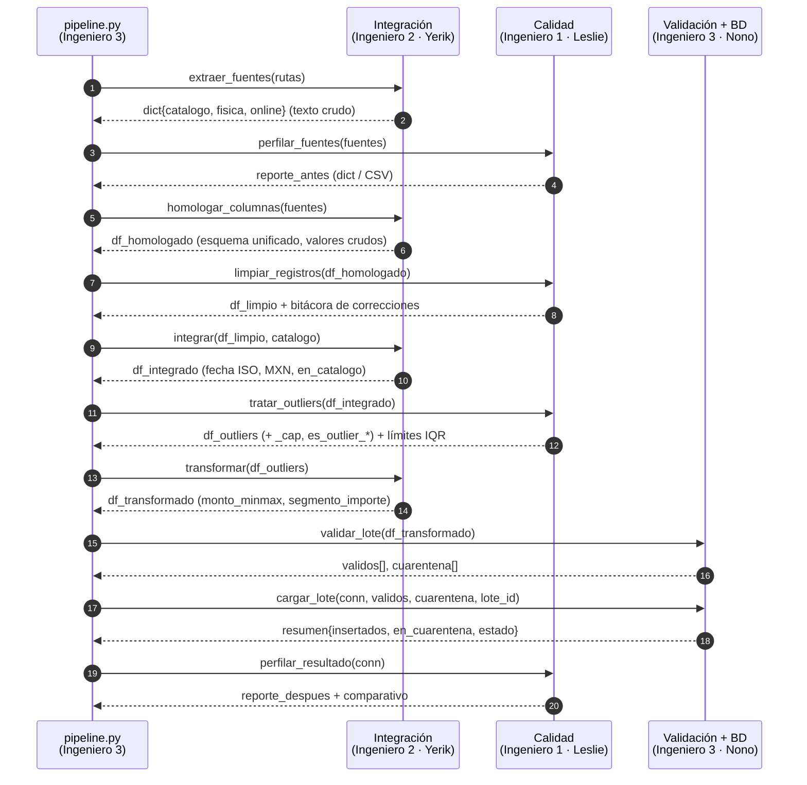
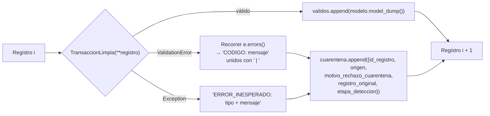

# DIAGRAMA DE FLUJO DEL PIPELINE ETL

**Proyecto:** Sistema de Integración y Calidad de Datos Comerciales *(nombre provisional)*
**Referencia:** `REGLAS_DE_NEGOCIO.md` (los identificadores R#.# del diagrama remiten a esas reglas)

> GitHub, GitLab y VS Code (con la extensión *Markdown Preview Mermaid Support*) muestran los diagramas directamente. Las versiones en imagen están en `diagramas/` para pegarlas en el reporte PDF.

---

## 1. Flujo completo: de los archivos originales a las tablas finales

```mermaid
flowchart TD
    %% ---------- EXTRACCIÓN ----------
    subgraph E["EXTRACCIÓN · Ingeniero 2"]
        A1[/"catalogo_productos.csv<br/>50 × 6"/]
        A2[/"ventas_tienda_fisica.csv<br/>620 × 9"/]
        A3[/"ventas_online.json<br/>600 × 11"/]
        EX["extraer_fuentes()<br/>lectura como texto + id_fila_origen<br/>+ registro_original JSON"]
        A1 --> EX
        A2 --> EX
        A3 --> EX
    end

    %% ---------- FASE 1 ----------
    EX --> F1["F1 · Diagnóstico inicial · Ingeniero 1<br/>completitud · unicidad · dtypes<br/>→ reporte ANTES"]
    F1 --> H["Homologación de columnas · Ingeniero 2<br/>esquema unificado + origen FISICA / ONLINE"]

    %% ---------- FASE 2 ----------
    subgraph F2["F2 · Faltantes e imputación · Ingeniero 1"]
        D1{"¿Fila idéntica<br/>a una anterior?"}
        D1 -- "Sí (20)" --> M1["bandera es_duplicado = True<br/>R2.3"]
        D1 -- No --> D2
        M1 --> D2
        D2{"¿monto nulo o<br/>≠ cantidad × precio?"}
        D2 -- "Sí (32 + 12)" --> C1["Recalcular monto<br/>guardar monto_total_origen<br/>R6.2 · R6.3"]
        D2 -- No --> D3
        C1 --> D3
        D3{"¿Categórica<br/>faltante?"}
        D3 -- "Sí (127 + 20 + 77)" --> C2["ANONIMO · SIN_CORREO · SIN_DIRECCION<br/>R3.8"]
        D3 -- No --> D4
        C2 --> D4
        D4{"¿cantidad nula?"}
        D4 -- "Sí (0)" --> C3["Mediana por canal<br/>R3.5"]
        D4 -- No --> F2OUT
        C3 --> F2OUT(["df_limpio"])
    end
    H --> D1

    %% ---------- FASE 4 ----------
    subgraph F4["F4 · Integración y huérfanos · Ingeniero 2"]
        T1["Fechas → YYYY-MM-DD<br/>3 formatos POS + ISO/epoch web<br/>R8"]
        T2{"¿moneda = USD?"}
        T2 -- "Sí (193)" --> T3["× 19.50 → MXN<br/>R7"]
        T2 -- "No (MXN)" --> T4
        T3 --> T4["LEFT JOIN catálogo<br/>bandera en_catalogo<br/>R9"]
    end
    F2OUT --> T1 --> T2

    %% ---------- FASE 3 ----------
    subgraph F3["F3 · Outliers IQR · Ingeniero 1"]
        O1["Base estadística: sin duplicados,<br/>cantidad > 0, en catálogo · R5.6"]
        O2["IQR cantidad por canal<br/>física LS = 8.5 → tope 8<br/>(13 recortes) · R5.3"]
        O3["IQR monto MXN unificado<br/>LS = 12,032.68<br/>(80 recortes) · R5.4"]
        O4["Columnas _cap + banderas<br/>es_outlier_* · R5.5"]
        O1 --> O2 --> O3 --> O4
    end
    T4 --> O1

    %% ---------- FASE 5 ----------
    subgraph F5["F5 · Transformación · Ingeniero 2"]
        S1["Min-Max [0,1] sobre<br/>monto_total_mxn_cap · R12.2"]
        S2["Terciles → Bajo / Medio / Alto<br/>R12.4"]
        S1 --> S2
    end
    O4 --> S1

    %% ---------- FASE 6 ----------
    subgraph F6["F6 · Validación Pydantic · Ingeniero 3"]
        V0["Para cada registro:<br/>try TransaccionLimpia(**fila)"]
        V1{"¿ValidationError<br/>u otra excepción?"}
        V0 --> V1
    end
    S2 --> V0

    V1 -- "No (≈ 1,104)" --> OK["Lista de registros válidos"]
    V1 -- "Sí (≈ 116)" --> QZ["Lista de cuarentena<br/>motivo_rechazo_cuarentena<br/>+ registro_original<br/>DUPLICADO · CANTIDAD_INVALIDA ·<br/>PRODUCTO_HUERFANO · EMAIL_MALFORMADO ·<br/>FECHA_INVALIDA · …"]

    %% ---------- FASE 7 ----------
    subgraph F7["F7 · Carga transaccional · Ingeniero 3"]
        B0["BEGIN"]
        B1{"¿Error al insertar?"}
        B2["conn.commit()"]
        B3["conn.rollback()<br/>0 filas parciales"]
        B0 --> B1
        B1 -- No --> B2
        B1 -- Sí --> B3
    end
    OK --> B0
    QZ --> B0

    B2 --> DB1[("transacciones_limpias")]
    B2 --> DB2[("cuarentena_errores")]
    B3 --> LOG["Bitácora del error<br/>el lote se reintenta"]
    DB1 --> F1D["F1 bis · Reporte DESPUÉS · Ingeniero 1<br/>comparación antes / después"]
    DB2 --> F1D

    classDef quar fill:#fde2e1,stroke:#c0392b,color:#7b241c;
    classDef db fill:#e3f2fd,stroke:#1565c0,color:#0d47a1;
    classDef ok fill:#e8f5e9,stroke:#2e7d32,color:#1b5e20;
    class QZ,B3,LOG quar;
    class DB1,DB2 db;
    class OK,B2 ok;
```

**Lectura del diagrama:**
1. **Ninguna fase anterior a la F6 elimina filas.** Solo agregan columnas corregidas y banderas (R1.3). Por eso el conteo siempre cuadra: 1,220 = limpias + cuarentena.
2. **El orden de ejecución es F1 → F2 → F4 → F3 → F5 → F6 → F7.** La Fase 3 se ejecuta después de la 4 porque el IQR del monto necesita todos los importes en MXN (ambigüedad A2).
3. Las cifras entre paréntesis salen del diagnóstico real (`diagnostico/resultados_diagnostico.json`). Las marcadas con "≈" son las esperadas, y el pipeline debe reproducirlas.

---

## 2. Contratos entre módulos: quién entrega qué a quién

---

## 3. Bifurcación de validación (detalle de la Fase 6)

